# REDES.md - Diseño de red del Quiz de Cultura General Argentina

E.P.E.T. N.º 1 UNESCO - Proyecto Integrador Final ExpoTécnica 2026
Materias: Programación II + Bases de Datos II + Seguridad Informática + Redes Informáticas

**Grupo 7**
Integrantes:
- Kannemann Dago
- Romero Matías

## 1. Organización y escenario

Imaginamos que nuestra aplicación, un quiz de preguntas de cultura general argentina, se usa dentro de la escuela (E.P.E.T. N.º 1), en la sala de informática. Los alumnos juegan desde las PCs de la sala y los visitantes (por ejemplo, en la ExpoTécnica) se conectan por Wi-Fi desde el celular.

La red tiene:
- 1 servidor de aplicación (donde corre Flask)
- 1 servidor de base de datos (donde corre MongoDB)
- PCs cableadas para los usuarios
- Wi-Fi para invitados, separado del resto
- 1 router con salida a Internet

## 2. Topología

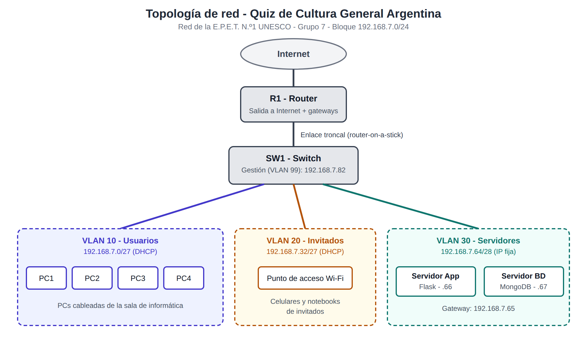

Red armada en Cisco Packet Tracer, con todos los enlaces en verde (funcionando):

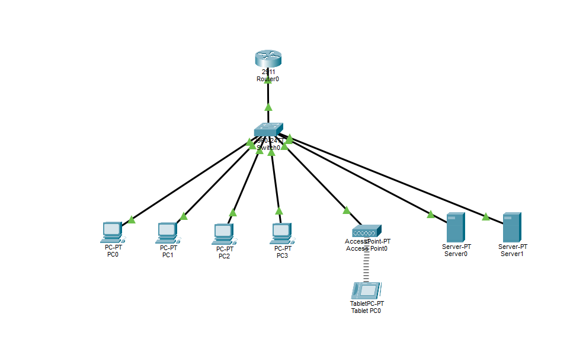

Equipos del diagrama:
- 1 router (R1)
- 1 switch (SW1), conectado al router con un enlace troncal
- 1 punto de acceso Wi-Fi
- 1 servidor de aplicación
- 1 servidor de base de datos
- 4 PCs de usuarios

La red simulada en Cisco Packet Tracer está en el archivo `red_quiz_grupo7.pkt` de este repositorio.

## 3. VLANs y direccionamiento

Nos asignaron el bloque **192.168.7.0/24** (grupo 7). Lo dividimos con VLSM según los equipos que necesita cada VLAN, empezando por la subred más grande.

| VLAN (ID y nombre) | Red / Prefijo | Máscara | Rango de hosts | Gateway | Hosts útiles |
|---|---|---|---|---|---|
| 10 - Usuarios | 192.168.7.0/27 | 255.255.255.224 | 192.168.7.1 - .30 | 192.168.7.1 | 30 |
| 20 - Invitados | 192.168.7.32/27 | 255.255.255.224 | 192.168.7.33 - .62 | 192.168.7.33 | 30 |
| 30 - Servidores | 192.168.7.64/28 | 255.255.255.240 | 192.168.7.65 - .78 | 192.168.7.65 | 14 |
| 99 - Gestión | 192.168.7.80/29 | 255.255.255.248 | 192.168.7.81 - .86 | 192.168.7.81 | 6 |

Como la tabla del TP, en "hosts útiles" contamos también la dirección del gateway, que es la primera de cada rango.

Quedan libres las direcciones desde 192.168.7.88 hasta 192.168.7.255 por si hay que agregar otra VLAN más adelante.

### Cómo hicimos el subnetting (VLSM)

| VLAN | Equipos que necesita (aprox.) | Prefijo elegido | Por qué |
|---|---|---|---|
| Usuarios | hasta 30 | /27 | Un /27 da 30 hosts útiles (32 direcciones - red - broadcast) |
| Invitados | hasta 30 | /27 | Misma cantidad, pensando en muchos celulares conectados |
| Servidores | 2 servidores + gateway | /28 | Un /28 da 14 hosts, sobra espacio para crecer |
| Gestión | switch + gateway | /29 | Un /29 da 6 hosts, es lo mínimo razonable |

Orden de asignación: primero las dos /27 (192.168.7.0 y 192.168.7.32), después la /28 (192.168.7.64) y al final la /29 (192.168.7.80). Así no se superponen y no se desperdician direcciones.

### Asignación de IPs

**Direcciones fijas:**

| Equipo | VLAN | IP |
|---|---|---|
| Router, subinterfaz VLAN 10 | 10 | 192.168.7.1 |
| Router, subinterfaz VLAN 20 | 20 | 192.168.7.33 |
| Router, subinterfaz VLAN 30 | 30 | 192.168.7.65 |
| Router, subinterfaz VLAN 99 | 99 | 192.168.7.81 |
| Servidor de aplicación (Flask) | 30 | 192.168.7.66 |
| Servidor de base de datos (MongoDB) | 30 | 192.168.7.67 |
| Switch SW1 (gestión) | 99 | 192.168.7.82 |

**DHCP:**
- Usuarios: de 192.168.7.2 a 192.168.7.30 (se excluye el .1 del gateway)
- Invitados: de 192.168.7.34 a 192.168.7.62 (se excluye el .33 del gateway)

## 4. Justificación de las decisiones

- **Separamos en VLANs** para que el tráfico de los invitados no se mezcle con el de los usuarios ni con el de los servidores. Con las ACL bloqueamos el acceso de invitados a los servidores.
- **Servidores en su propia VLAN** para poder controlar quién llega a la aplicación y a la base de datos.
- **IP fija para los servidores** porque el DNS y las reglas de acceso tienen que apuntar siempre al mismo lugar. Usuarios e invitados usan DHCP porque los equipos cambian seguido.
- **VLSM** para no desperdiciar direcciones: cada VLAN tiene el tamaño que necesita.
- **VLAN de gestión** para poder administrar el switch por SSH sin usar la red de los usuarios.
- **Router-on-a-stick:** un solo cable entre el router y el switch con subinterfaces, porque alcanza para esta red y usa pocos equipos.

## 5. Configuración en Packet Tracer

Estos son los fragmentos más importantes de lo que configuramos. Las contraseñas reales no se muestran.

### 5.1 Switch SW1: VLANs, puertos y enlace troncal

```
vlan 10
 name Usuarios
vlan 20
 name Invitados
vlan 30
 name Servidores
vlan 99
 name Gestion

interface range fastEthernet 0/2 - 5
 switchport mode access
 switchport access vlan 10
interface fastEthernet 0/6
 switchport mode access
 switchport access vlan 20
interface range fastEthernet 0/7 - 8
 switchport mode access
 switchport access vlan 30

interface fastEthernet 0/1
 switchport mode trunk
 switchport trunk allowed vlan 10,20,30,99

interface vlan 99
 ip address 192.168.7.82 255.255.255.248
 no shutdown
ip default-gateway 192.168.7.81
```

### 5.2 Router R1: enrutamiento entre VLANs (router-on-a-stick)

```
interface gigabitEthernet 0/0
 no shutdown
interface gigabitEthernet 0/0.10
 encapsulation dot1Q 10
 ip address 192.168.7.1 255.255.255.224
interface gigabitEthernet 0/0.20
 encapsulation dot1Q 20
 ip address 192.168.7.33 255.255.255.224
interface gigabitEthernet 0/0.30
 encapsulation dot1Q 30
 ip address 192.168.7.65 255.255.255.240
interface gigabitEthernet 0/0.99
 encapsulation dot1Q 99
 ip address 192.168.7.81 255.255.255.248
```

### 5.3 DHCP (en el router)

```
ip dhcp excluded-address 192.168.7.1
ip dhcp excluded-address 192.168.7.33

ip dhcp pool USUARIOS
 network 192.168.7.0 255.255.255.224
 default-router 192.168.7.1
 dns-server 192.168.7.66

ip dhcp pool INVITADOS
 network 192.168.7.32 255.255.255.224
 default-router 192.168.7.33
 dns-server 192.168.7.66
```

### 5.4 DNS y servidor web

En el servidor de aplicación (192.168.7.66) activamos los servicios DNS y HTTP. El DNS tiene un registro tipo A: `app.expotecnica.local` apunta a `192.168.7.66`.

### 5.5 Acceso seguro por SSH (router y switch)

```
enable secret ********
service password-encryption
banner motd #Acceso solo para personal autorizado#

ip domain-name expotecnica.local
username admin secret ********
crypto key generate rsa general-keys modulus 1024
ip ssh version 2

line console 0
 password ********
 login
line vty 0 4
 transport input ssh
 login local
```

En el switch es lo mismo, con `line vty 0 15`. Con `transport input ssh` el acceso remoto solo se permite por SSH, no por Telnet.

### 5.6 ACL (listas de control de acceso)

```
ip access-list extended ACL_INVITADOS
 deny ip 192.168.7.32 0.0.0.31 192.168.7.64 0.0.0.15
 permit ip any any

ip access-list extended ACL_USUARIOS
 permit udp 192.168.7.0 0.0.0.31 host 192.168.7.66 eq 53
 permit tcp 192.168.7.0 0.0.0.31 host 192.168.7.66 eq 80
 permit icmp 192.168.7.0 0.0.0.31 host 192.168.7.66
 deny ip 192.168.7.0 0.0.0.31 192.168.7.64 0.0.0.15
 permit ip any any

ip access-list extended ACL_SERVIDORES_OUT
 deny tcp any host 192.168.7.67 eq 27017
 permit ip any any

interface gigabitEthernet 0/0.20
 ip access-group ACL_INVITADOS in
interface gigabitEthernet 0/0.10
 ip access-group ACL_USUARIOS in
interface gigabitEthernet 0/0.30
 ip access-group ACL_SERVIDORES_OUT out
```

Qué hace cada una:
- **ACL_INVITADOS:** los invitados no pueden acceder a la VLAN de Servidores. Todo lo demás pasa.
- **ACL_USUARIOS:** los usuarios llegan al servidor de aplicación solo por DNS (53) y web (80). Dejamos el ping (ICMP) a ese servidor para poder hacer pruebas de conectividad. Al resto de la VLAN de Servidores, incluida la base de datos, no pueden llegar.
- **ACL_SERVIDORES_OUT:** bloquea el puerto de MongoDB (27017) para todo el tráfico que viene de otras VLANs.

Como el servidor de aplicación y el de base de datos están en la misma VLAN, la comunicación entre ellos no pasa por el router y las ACL no la afectan. Por eso la regla del puerto 27017 bloquea el tráfico de afuera de la VLAN y el servidor de aplicación sigue pudiendo conectarse a MongoDB.

Como consecuencia de la ACL de invitados, ellos tampoco llegan al servidor DNS (192.168.7.66), así que desde la red de invitados no se resuelven nombres. Lo aceptamos porque el requisito era que no accedan a la VLAN de Servidores.

## 6. Registro de pruebas

### Pruebas exitosas

| N.º | Prueba | Resultado | Captura |
|---|---|---|---|
| 1 | Ping desde el servidor de aplicación al gateway (192.168.7.65) y al servidor de base de datos (192.168.7.67) | Responde, 0% de pérdida | 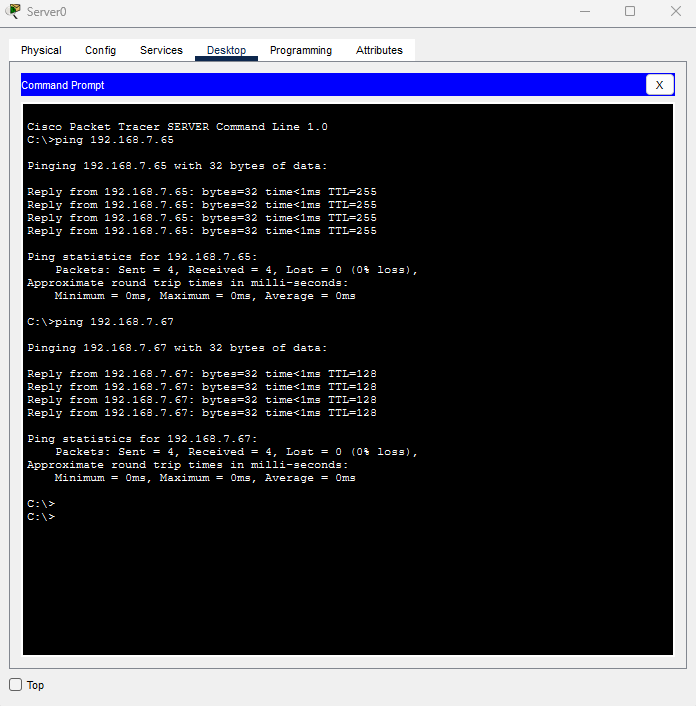 |
| 2 | Página web por nombre: `http://app.expotecnica.local` desde una PC | Carga la página, funcionan el DNS y el servidor web | 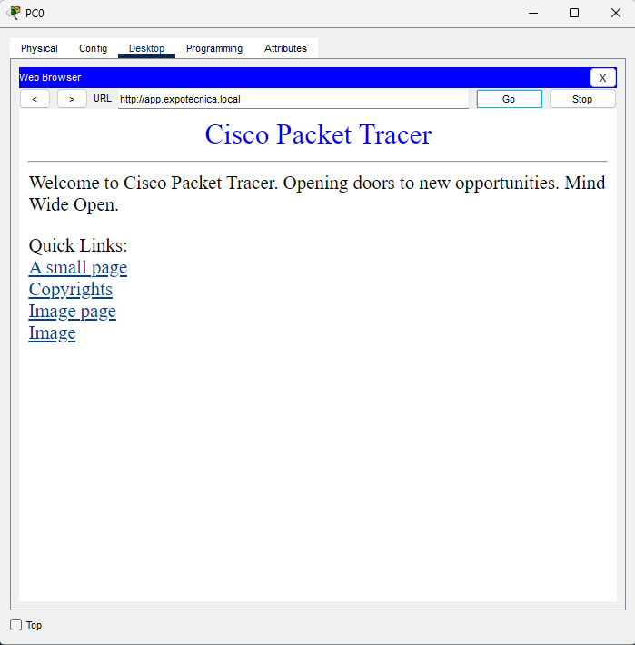 |
| 3 | Acceso por SSH al router desde una PC | Con contraseña incorrecta rechaza (Login invalid); con la correcta muestra el banner y entra | 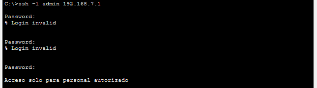 |
| 4 | Acceso por SSH al switch (192.168.7.82) desde una PC | Pide contraseña, muestra el banner y entra | 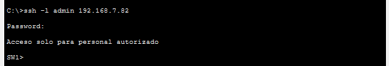 |

### Pruebas fallidas (el bloqueo funciona)

| N.º | Prueba | Resultado | Captura |
|---|---|---|---|
| 5 | Telnet al router (192.168.7.1) | La conexión se abre y se cierra enseguida, no deja entrar | 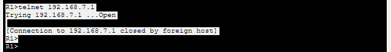 |
| 6 | Ping desde una PC de usuarios al servidor de base de datos (192.168.7.67) | Bloqueado por la ACL (destination host unreachable) | 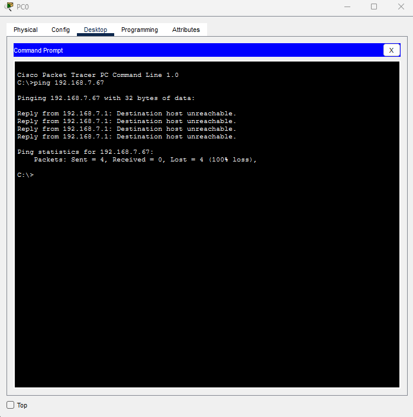 |
| 7 | Web desde la tablet de invitados al servidor de aplicación (192.168.7.66) | Request Timeout, bloqueado por la ACL | 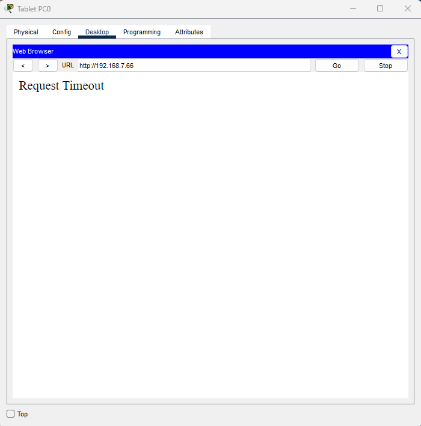 |
| 8 | Comando `show access-lists` después de las pruebas | Las reglas `deny` muestran coincidencias (match) | 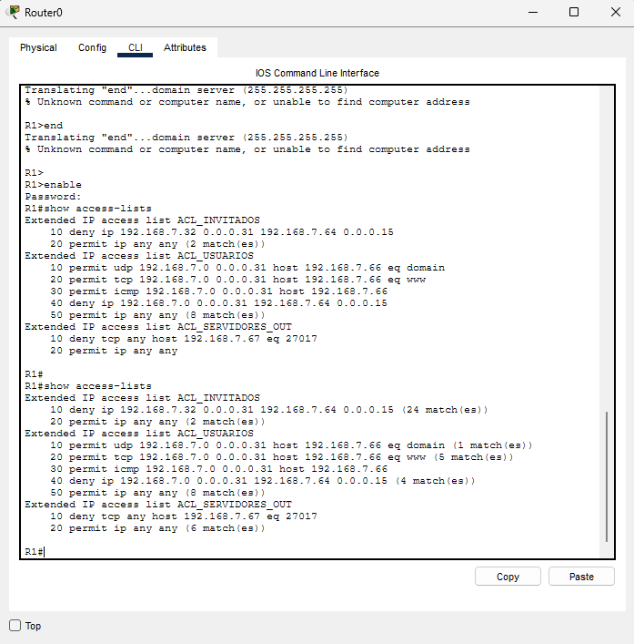 |

### Verificación de la configuración segura

| N.º | Prueba | Resultado | Captura |
|---|---|---|---|
| 9 | `show running-config \| include secret` y `show running-config \| include service` en el router | Las contraseñas del `enable secret` y del usuario `admin` aparecen cifradas (tipo 5) y está activo `service password-encryption` | 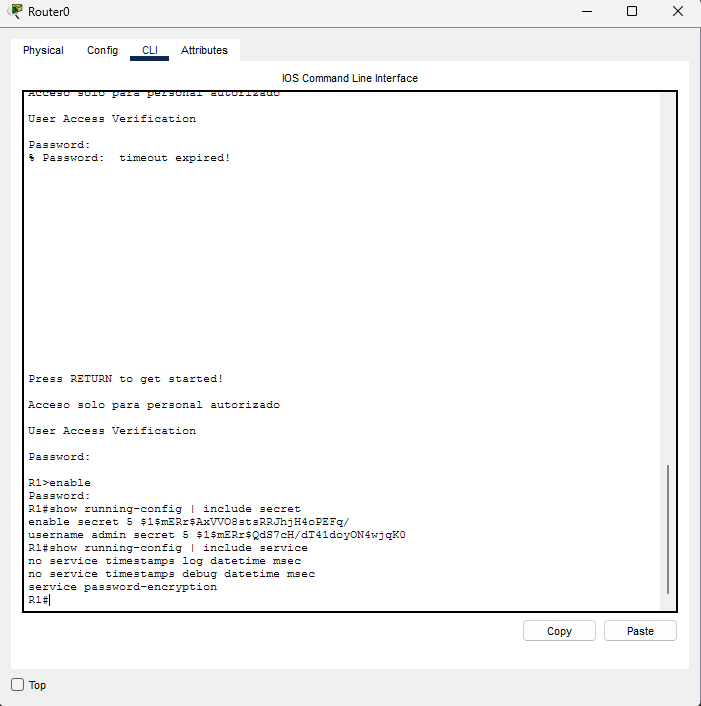 |

La regla del puerto 27017 se comprueba mirando la ACL con `show access-lists`: Packet Tracer no tiene una herramienta para probar un puerto TCP específico desde una PC.

## 7. Bitácora de resolución de problemas

**Problema 1: no sabíamos qué tipo de router usar.**
Al armar la red, Packet Tracer ofrecía varios routers (Home Router, PT-Empty, PT-Router y los modelos Cisco).
Causa: el Home Router se configura por una página web y no deja crear subinterfaces ni ACL por consola, y el PT-Empty no trae puertos.
Solución: usamos el router **Cisco 2911**, que se configura por línea de comandos.

**Problema 2: error "Unknown command or computer name" en el router.**
Al escribir `end` en el router apareció `Translating "end"...domain server` seguido del mensaje de error (captura: 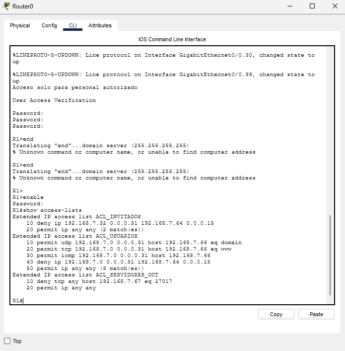).
Causa: ya estábamos fuera del modo de configuración, y `end` solo es un comando válido adentro de ese modo. El router interpreta cualquier palabra que no reconoce como el nombre de un equipo y trata de resolverla por DNS.
Solución: mirar el prompt antes de escribir (`R1>`, `R1#` o `R1(config)#`). Para ver las ACL hay que entrar con `enable` (prompt `R1#`) y usar `show access-lists`.

**Problema 3: el SSH desde la PC no dejaba entrar.**
Al principio el comando devolvía `Invalid Command` y después `Login invalid`.
Causa: se escribió `ssh -1` (con el número uno) en lugar de `ssh -l` (con la letra ele), y la contraseña del usuario `admin` se ingresó mal.
Solución: usar `ssh -l admin 192.168.7.1` con la contraseña correcta. La captura de la prueba 3 muestra los intentos rechazados y después el ingreso exitoso, con el banner.

## 8. Integración Redes + Seguridad

Las amenazas son los riesgos identificados en el `SECURITY.md`.

| Medida de red | Amenaza que mitiga (de SECURITY.md) | Cómo se verificó |
|---|---|---|
| ACL que bloquea Invitados → Servidores | Riesgo 1 (manipulación de puntajes con Postman o scripts) y Riesgo 4 (acceso no autorizado al panel de administración): desde la red de invitados no se llega a las rutas de la aplicación | Acceso desde la tablet al servidor: Request Timeout (prueba 7) |
| ACL que limita a Usuarios al servidor de aplicación, solo por DNS y HTTP | Riesgo 4 (acceso no autorizado): los puestos de usuario no pueden llegar a otros servicios de la VLAN de Servidores, como la base de datos | Ping de una PC a 192.168.7.67 bloqueado (prueba 6) y web por nombre funcionando (prueba 2) |
| ACL que bloquea el puerto 27017 desde otras VLANs | Riesgo 4 (credenciales expuestas): aunque alguien conociera la clave de la base (MONGO_URI), no puede conectarse a MongoDB desde otra VLAN | Regla activa en show access-lists (prueba 8) |
| Segmentación en VLANs | Riesgo 1 y Riesgo 4: reduce quién puede alcanzar el servidor de aplicación y la base de datos | Los invitados no llegan a la VLAN de Servidores (prueba 7) |
| SSH en lugar de Telnet | Riesgo 4 (acceso no autorizado), aplicado a los equipos de red: la clave de administración no viaja sin cifrar | Telnet se cierra y SSH entra con el banner (pruebas 3, 4 y 5) |
| Contraseñas cifradas (enable secret y service password-encryption) | Riesgo 4 (credenciales expuestas), aplicado a los equipos de red: si alguien ve la configuración, no puede leer las claves | show running-config muestra las contraseñas cifradas (prueba 9) |

Los riesgos 2 (estado de la partida en la cookie), 3 (entradas inválidas y errores internos) y 5 (XSS por el nombre del jugador) del SECURITY.md se reducen en el código de la aplicación, con validaciones, el escape automático de Jinja2 y el manejo de errores. Las medidas de red de esta tabla no los cubren.
